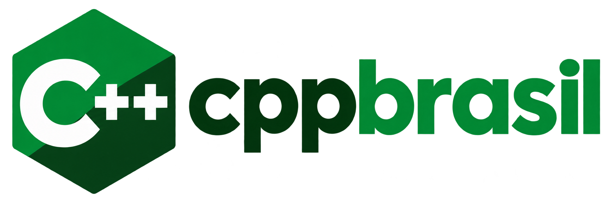

# Projeto C++ Brasil


Bibliotecas multiplataforma em C++ e Qt para o desenvolvimento de software ERP, com foco nos documentos fiscais
eletrônicos brasileiros.

## Bibliotecas

| Biblioteca | Pasta | Função |
|---|---|---|
| `CppBase` | `CppBase/` | Base comum: XML (libxml2), criptografia e certificado (OpenSSL), HTTP e utilitários. Obrigatória. |
| `CppNFe` | `CppNFe/` | Geração, leitura, assinatura, validação e transmissão de NF-e (modelo 55) e NFC-e (modelo 65). |
| `CppDanfe` | `CppDanfe/` | Dados e regras do DANFE. Opcional. |
| `CppDanfeBrReport` | `DanfeBrReport/` | Impressão do DANFE da NF-e com o [BrReport](https://github.com/cppbr/BrReport), no leiaute da NT 2026.010. Opcional. |

Veja o [CHANGELOG](CHANGELOG.md) para as mudanças de cada versão, inclusive as que quebram compatibilidade.

Ambientes testados: Linux, Windows e Android.

# Requisitos

| Dependência | Versão | Observação |
|---|---|---|
| Compilador C++17 | GCC, Clang, MSVC 2022 ou superior, MinGW/llvm-mingw | |
| CMake | 3.16 ou superior | O CMake e o Ninja que acompanham o Qt servem. |
| Qt | 6.5 ou superior | Módulos `Core` e `Network`. O Qt 5 não é mais suportado. |
| OpenSSL | 1.1.1 ou superior | Recomendado 3.x; a série 1.1.1 está fora de suporte. |
| libxml2 | 2.12 ou superior | Recomendado 2.13 ou superior (veja [libxml2](#libxml2-versão-e-recompilação)). |
| zlib | qualquer | No Windows, sem zlib instalada, é usada a que acompanha o Qt. |
| BrReport | 0.2 ou superior | Apenas para o DANFE; exige também os módulos `Gui`, `Widgets` e `PrintSupport` do Qt. |
| libiconv | | Apenas se a libxml2 tiver sido compilada com ela. |

As dependências não acompanham o projeto: instale-as antes de compilar. O BrReport é compilado e instalado com o
CMake, pelas instruções do próprio projeto, com o mesmo kit do Qt usado na CppBrasil.

> **Use o mesmo compilador em tudo.** Qt, OpenSSL, libxml2, CppBrasil e a sua aplicação devem ser compilados com o
> mesmo compilador e a mesma versão do runtime. Misturar MSVC com MinGW, ou versões diferentes do GCC do MinGW, corrompe
> a memória em tempo de execução, mesmo quando a compilação e a ligação funcionam.

# Compilação

A compilação é feita pelo `CMakeLists.txt` da raiz do projeto, sempre em uma pasta separada do código-fonte.

| Opção do CMake | Padrão | Função |
|---|---|---|
| `CPPBRASIL_BUILD_DANFE` | `ON` | Compila a `CppDanfe` e a `CppDanfeBrReport`, que exige o BrReport. Use `OFF` para compilar sem o DANFE. |
| `CMAKE_PREFIX_PATH` | | Kit do Qt e, no Windows, as pastas de instalação da libxml2 e do BrReport (separados por `;`). |
| `OPENSSL_ROOT_DIR` | | Pasta de instalação do OpenSSL, quando fora dos caminhos padrão. |
| `CMAKE_INSTALL_PREFIX` | `/usr` no Linux | Destino do `cmake --install`. |

Os binários ficam em `<pasta de build>/bin` (executáveis e DLLs) e `<pasta de build>/lib`.

## Linux

### 1. Dependências

Debian e Ubuntu:

```bash
sudo apt install build-essential cmake ninja-build libssl-dev libxml2-dev zlib1g-dev
```

Fedora e RHEL:

```bash
sudo dnf install gcc-c++ cmake ninja-build openssl-devel libxml2-devel zlib-devel
```

O Qt pode vir da distribuição (por exemplo, `qt6-base-dev` no Debian/Ubuntu ou `qt6-qtbase-devel` no Fedora), desde
que seja 6.5 ou superior, ou do instalador oficial do Qt. No Fedora/RHEL, libere a assinatura SHA1
(veja [abaixo](#fedorarhel-e-derivados-assinatura-sha1)).

### 2. Configurar e compilar

Sem o DANFE:

```bash
cmake -S . -B build/release -G Ninja -DCMAKE_BUILD_TYPE=Release -DCPPBRASIL_BUILD_DANFE=OFF
```

```bash
cmake --build build/release
```

Com o Qt do instalador oficial, informe o kit:

```bash
cmake -S . -B build/release -G Ninja -DCMAKE_BUILD_TYPE=Release -DCMAKE_PREFIX_PATH=$HOME/Qt/6.12.0/gcc_64 -DCPPBRASIL_BUILD_DANFE=OFF
```

Com o DANFE, depois de instalar o BrReport (informe a pasta de instalação se ela não for padrão do sistema):

```bash
cmake -S . -B build/release -G Ninja -DCMAKE_BUILD_TYPE=Release -DCMAKE_PREFIX_PATH=/caminho/BrReport
```

### 3. Instalar

```bash
sudo cmake --install build/release
```

O destino padrão é `/usr`. Para instalar em outro lugar, sem `sudo`, configure com
`-DCMAKE_INSTALL_PREFIX=$HOME/.local` (ou outra pasta) e rode `cmake --install build/release`.

## Windows

No Windows não há gerenciador de pacotes padrão para as dependências: o OpenSSL e a libxml2 precisam ser instalados ou
compilados para o mesmo compilador do kit do Qt. O caminho principal é o **MSVC**; o MinGW também funciona, com as
ressalvas abaixo.

Todos os comandos abaixo são executados no **x64 Native Tools Command Prompt** do Visual Studio (ou em um prompt em que
o `vcvars64.bat` já foi chamado) e com o CMake e o Ninja do Qt no `PATH`:

```bat
set PATH=C:\Qt\Tools\CMake_64\bin;C:\Qt\Tools\Ninja;%PATH%
```

### 1. Qt

Instale pelo instalador oficial o kit **MSVC 2022 64-bit** (`msvc2022_64`). Os exemplos usam `C:\Qt\6.12.0`; ajuste
para a sua versão.

### 2. OpenSSL (MSVC)

Instale o OpenSSL 3.x para Windows 64 bits na versão completa, que traz os cabeçalhos e as bibliotecas de importação
(o pacote "Light" traz só as DLLs). Por exemplo, o instalador "Win64 OpenSSL" de
[slproweb.com](https://slproweb.com/products/Win32OpenSSL.html). A pasta de instalação é a que vai em
`OPENSSL_ROOT_DIR`.

### 3. libxml2 (MSVC)

Não há binários oficiais da libxml2 para Windows; compile-a a partir do código-fonte
([GNOME/libxml2](https://gitlab.gnome.org/GNOME/libxml2/-/releases)) com o mesmo compilador. Sem iconv, zlib e
Python, ela não tem dependências externas, e a CppBrasil não precisa delas:

```bat
cmake -S libxml2-2.15.4 -B libxml2-build -G Ninja -DCMAKE_BUILD_TYPE=Release -DCMAKE_INSTALL_PREFIX=C:\deps\libxml2-msvc -DBUILD_SHARED_LIBS=ON -DLIBXML2_WITH_ICONV=OFF -DLIBXML2_WITH_ZLIB=OFF -DLIBXML2_WITH_PYTHON=OFF -DLIBXML2_WITH_TESTS=OFF -DLIBXML2_WITH_DOCS=OFF
```

```bat
cmake --build libxml2-build
```

```bat
cmake --install libxml2-build
```

Os módulos usados pela CppBrasil (C14N, para a assinatura, e Schemas, para a validação pelo XSD) já vêm ligados por
padrão.

### 4. Configurar e compilar a CppBrasil

```bat
cmake -S . -B build\msvc -G Ninja -DCMAKE_BUILD_TYPE=Release -DCMAKE_PREFIX_PATH="C:/Qt/6.12.0/msvc2022_64;C:/deps/libxml2-msvc" -DOPENSSL_ROOT_DIR="C:/Program Files/OpenSSL-Win64" -DCPPBRASIL_BUILD_DANFE=OFF
```

```bat
cmake --build build\msvc
```

Para compilar o DANFE, instale o BrReport compilado com o mesmo kit, retire `-DCPPBRASIL_BUILD_DANFE=OFF` e
acrescente a pasta de instalação dele ao `CMAKE_PREFIX_PATH`, por exemplo `"C:/Qt/6.12.0/msvc2022_64;C:/deps/libxml2-msvc;C:/deps/BrReport"`.

Para instalar, configure também `-DCMAKE_INSTALL_PREFIX=C:\deps\cppbrasil` e rode `cmake --install build\msvc`.

### 5. Executar

A aplicação precisa encontrar, no `PATH` ou na própria pasta do executável, as DLLs da CppBrasil (`CppBase.dll`,
`CppNFe.dll`), do Qt (ou use o `windeployqt`), da libxml2 (`libxml2.dll`) e do OpenSSL (`libcrypto-3-x64.dll` e
`libssl-3-x64.dll`). Com o DANFE no BrReport, também `CppDanfe.dll`, `CppDanfeBrReport.dll`, `brreportcore.dll` e
`brreportwidgets.dll`.

### MinGW

- Qt, OpenSSL, libxml2 e a CppBrasil devem usar exatamente o mesmo toolchain MinGW. O kit `mingw_64` do Qt é compilado
  com uma versão do GCC que pode ser diferente da do MinGW oferecido no instalador; confira a versão nas notas do kit.
  O kit `llvm-mingw_64`, com o toolchain llvm-mingw correspondente do instalador, é a combinação testada.
- Compile a libxml2 como no passo 3, com o compilador do toolchain MinGW.
- O OpenSSL incluído em `C:\Qt\Tools\mingw*\opt` é da série 1.1.1, fora de suporte. Prefira um OpenSSL 3.x compilado
  com o mesmo toolchain e informe a pasta em `OPENSSL_ROOT_DIR`.

## Uso na aplicação

Os includes seguem o nome do módulo (`<CppNFe/...>`, `<CppBase/...>`, `<CppDanfe/...>` e `<DanfeBrReport/...>`), e
a `CppBase` é obrigatória: ligue `-lCppNFe -lCppBase`. Para o DANFE, use
`-lCppDanfeBrReport -lCppDanfe -lCppNFe -lCppBase` (os cabeçalhos do BrReport não são necessários na aplicação). Em
um projeto CMake que inclui a CppBrasil com
`add_subdirectory`, basta ligar ao alvo `CppNFe` ou `CppDanfeBrReport`.

```cpp
#include <DanfeBrReport/CppDanfeBrReport>

CppDanfeBrReport danfe(cppnfe, 0);     // nota de índice 0 em cppnfe->notafiscal->NFe
danfe.caminhoLogo("logo.png");         // opcional
danfe.exportarPDF("danfe.pdf");        // ou print() para a visualização, imprimir() para a impressora
```

O leiaute fica embutido na biblioteca. Para personalizá-lo, grave-o com `salvarModelo("danfe.brt")`, altere o arquivo no
`brdesigner` do BrReport e informe-o em `caminhoArquivo()`.

Os XSDs da NF-e não acompanham a biblioteca: informe a pasta deles na configuração (`ConfigNFe::arquivos`) para que a
assinatura e a validação funcionem.

# Avisos importantes

## Fedora/RHEL e derivados: assinatura SHA1
A NF-e é assinada com **RSA-SHA1**, e o OpenSSL do Fedora/RHEL (e derivados, como CentOS Stream, Rocky, Alma e Nobara)
bloqueia assinaturas SHA1 por padrão. Sem liberar, `assinar()` falha com "Erro ao assinar documento"
(`evp_pkey_ctx_set_md: invalid digest`). Libere de uma das formas:

- No sistema todo: `sudo update-crypto-policies --set DEFAULT:SHA1` (para voltar: `--set DEFAULT`).
- Só na aplicação: aponte a variável `OPENSSL_CONF` para um arquivo como este:

```ini
openssl_conf = openssl_init

[openssl_init]
alg_section = evp_properties

[evp_properties]
rh-allow-sha1-signatures = yes
```

Windows, Debian e Ubuntu não têm esse bloqueio.

## libxml2: versão e recompilação
- **2.13 ou superior (recomendado):** erros de leitura dos XSDs incluídos pelo schema principal (por exemplo, um
  `leiauteNFe_v4.00.xsd` corrompido) aparecem na mensagem de erro da validação. Na 2.12 ou anterior, esse erro também é
  impresso no stderr da aplicação.
- **2.14 ou superior: o arquivo da biblioteca mudou** de `libxml2.so.2` para `libxml2.so.16` (no Windows, a DLL também
  pode mudar de nome). Ao atualizar a libxml2 a partir da 2.13 ou anterior, **recompile a CppBrasil e a sua aplicação**
  contra a versão nova; os binários compilados com a antiga não carregam a nova.
- A biblioteca funciona com a libxml2 compilada sem a interface antiga SAX1 (`--without-sax1`) e sem iconv.

# Autor
João Elson.

**Site do projeto e fórum para suporte, interação e sugestões**
- https://cppbrasil.com.br
