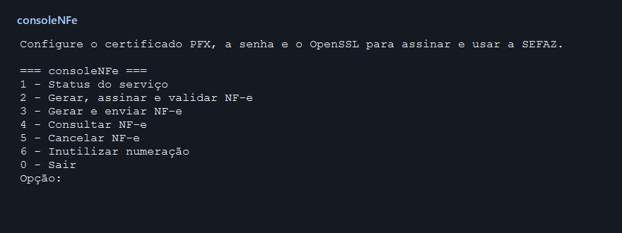
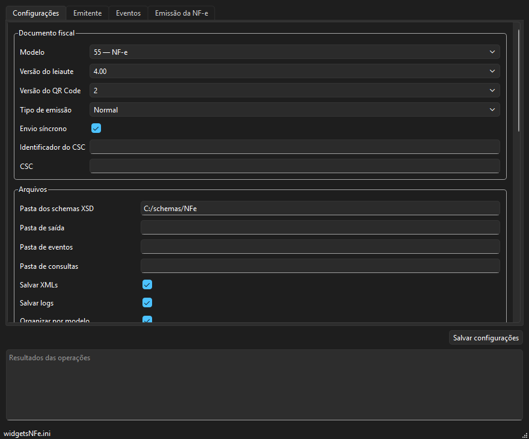
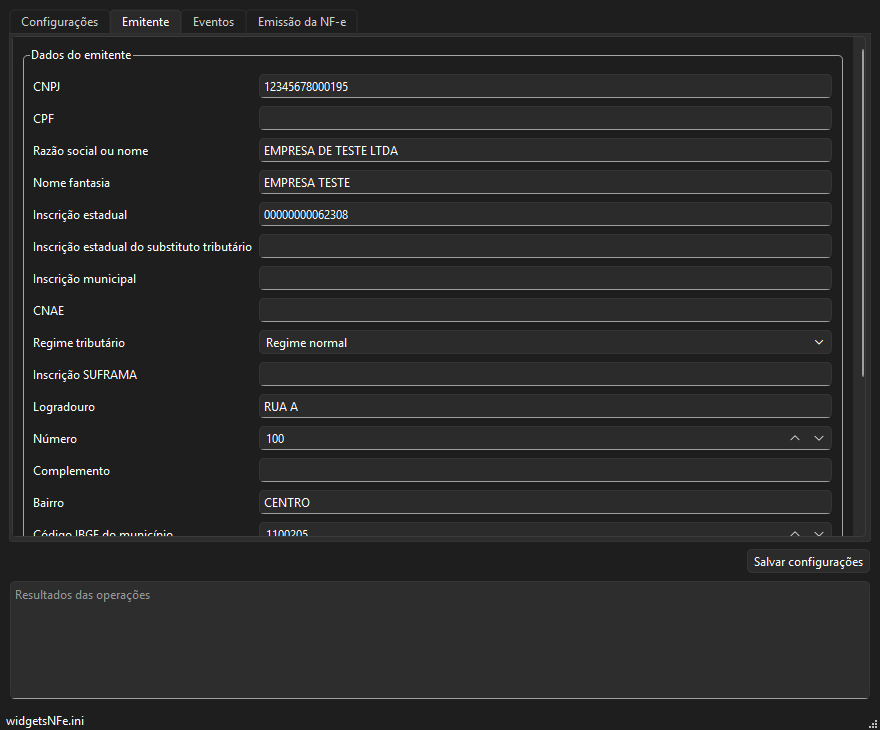
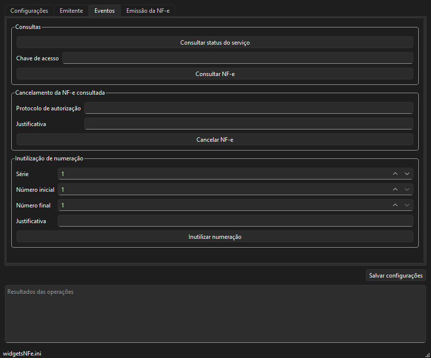
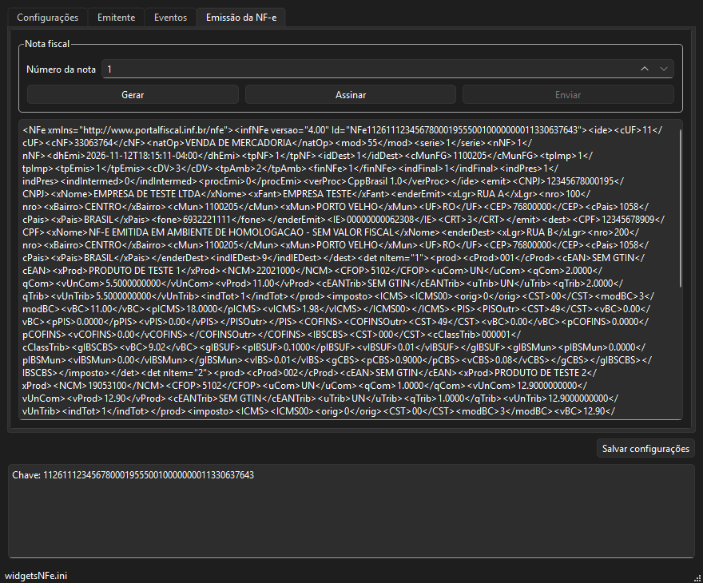

# Exemplos da CppNFe

O **consoleNFe** oferece um menu e comandos para testar a biblioteca pelo
terminal. O **widgetsNFe** apresenta o mesmo fluxo em uma interface Qt Widgets
com configuração em INI e prévia do XML.

## Compilar

Na raiz do repositório, com o Qt 6.5 ou superior e as dependências da CppNFe:

```bash
cmake -S examples -B build/examples -G Ninja -DCMAKE_BUILD_TYPE=Release
cmake --build build/examples
```

No Windows, passe o `CMAKE_PREFIX_PATH` e o `OPENSSL_ROOT_DIR` na primeira
linha, usando o mesmo kit para Qt e demais dependências. Consulte as
[instruções de compilação para Windows](../README.md#windows) ou
[Linux](../README.md#linux). Use `-DCPPBRASIL_EXAMPLES_WIDGETS=OFF` para
compilar apenas o console.

Os executáveis e o modelo de configuração ficam em `build/examples/bin`.
No Windows, use o `windeployqt` do kit da compilação para copiar as DLLs e
plugins do Qt. Para disponibilizar a libxml2 e o OpenSSL, siga as
[instruções de execução no Windows](../README.md#5-executar).

```powershell
windeployqt --release .\build\examples\bin\widgetsNFe.exe
```

## Console

Na raiz do repositório, copie o modelo para o INI do console e abra o menu.
No Windows, execute no PowerShell:

```powershell
Copy-Item .\examples\console\consoleNFe.ini.exemplo .\build\examples\bin\consoleNFe.ini
.\build\examples\bin\consoleNFe.exe
```

No Linux:

```bash
cp examples/console/consoleNFe.ini.exemplo build/examples/bin/consoleNFe.ini
./build/examples/bin/consoleNFe
```



Você também pode executar um comando diretamente. Por exemplo, para
gerar, assinar e validar a nota no Windows:

```powershell
.\build\examples\bin\consoleNFe.exe gerar
```

O comando `gerar` exibe o XML original quando o certificado não está
disponível. Com o PFX e os schemas configurados, ele assina e valida pelo
XSD. Use `--help` para ver os argumentos de `status`, `enviar`,
`consultar`, `cancelar` e `inutilizar`. A opção `--config arquivo.ini`
seleciona outro INI.

## Qt Widgets

Para abrir a interface com os dados fictícios das capturas, copie o modelo
para um INI próprio do Widgets. No Windows:

```powershell
Copy-Item .\examples\console\consoleNFe.ini.exemplo .\build\examples\bin\widgetsNFe.ini
.\build\examples\bin\widgetsNFe.exe --config .\build\examples\bin\widgetsNFe.ini
```

No Linux:

```bash
cp examples/console/consoleNFe.ini.exemplo build/examples/bin/widgetsNFe.ini
./build/examples/bin/widgetsNFe --config build/examples/bin/widgetsNFe.ini
```

Sem `--config`, o Widgets usa o INI na pasta de configuração do usuário.
O caminho aparece na barra de status. Use **Salvar configurações** para
gravar as alterações imediatamente.

### Configurações

Selecione o modelo, o ambiente e a UF autorizadora. Role a aba para
configurar as pastas dos schemas e dos XMLs, o certificado PFX, os web
services e o proxy. O modelo inicial usa homologação.



### Emitente

Preencha o CNPJ ou CPF, o nome, as inscrições, o regime tributário e o
endereço. Os dados da captura são fictícios.



### Eventos

Consulte o status do serviço ou uma nota pela chave de acesso. Para
cancelamento, informe também o protocolo e a justificativa. A
inutilização usa série, faixa de números e justificativa.



### Emissão da NF-e

1. Informe o número e clique em **Gerar** para obter a chave de acesso e ver o XML.
2. Clique em **Assinar** com o PFX e os schemas configurados. O exemplo valida o XML assinado pelo XSD.
3. Clique em **Enviar** para transmitir a nota assinada ao ambiente selecionado.



As capturas mostram apenas operações locais com dados fictícios. Para usar
a senha do certificado via ambiente, deixe o campo de senha vazio e defina
`CPPBR_CERT_SENHA`. Valores digitados nos campos de senha ficam no INI.

Para alterar os dados fixos da nota, como destinatário, produtos, tributos,
série padrão e lote, edite [nfe.h](nfe.h) e recompile. O console e o Widgets
usam as mesmas funções de emissão e eventos em [nfe.cpp](nfe.cpp).
